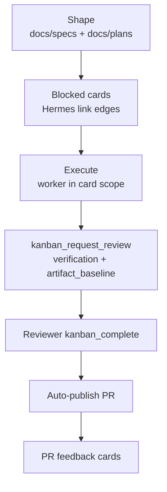

# Ginflow system — spec-first flow

> Derived from [`ginflow-system.drawio`](./ginflow-system.drawio), page **Ginflow system**.
> Draw.io remains canonical. Update Draw.io first, then update this derived explanation; it is not mechanically generated.

## Problem

Autonomous agent work needs scope, evidence, and a reviewable result. Ginflow shapes one spec and plan per card, gates completion on evidence, and publishes a PR.

- Hermes owns profiles, runtime, tools, Kanban state, skill loading, and lifecycle.
- `ginflow-gate` injects bounded guidance and validates evidence at native transitions.
- Target project owns product code, local rules, tests, and canonical verification.
- User approves the shaped artifacts and resolves decisions that artifacts cannot settle.

## Spec-first flow

1. **Shape** — write `docs/specs/<KEY>.md` and `docs/plans/<KEY>.md` (front matter `card`, `assignee`, `blocked_by`).
2. **Cards** — create blocked Hermes cards linking the artifacts; dependencies are Hermes `link` edges.
3. **Execute** — worker implements inside card scope on its branch and runs canonical verification.
4. **Review** — worker calls `kanban_request_review` with `verification_result` and `artifact_baseline`; reviewer calls `kanban_complete`.
5. **PR** — `ginflow-gate` pushes the branch and opens the PR after reviewer completion.
6. **Feedback** — PR feedback becomes new cards.

Decision: [ADR 0002](../adrs/0002-spec-first-cards.md).

## Authority and route boundary

| Concern | Authority |
| --- | --- |
| Identity, Kanban, cards, assignment, dispatch, persistence, lifecycle | Hermes |
| Routing and config validation | Ginflow core |
| Native completion evidence enforcement, publish | `ginflow-gate` |
| Product behavior and canonical verification | Target project |
| Intent and approval | Human operator |

## Runtime hooks (ginflow-gate)

| Hermes hook | Handler | Effect |
| --- | --- | --- |
| `pre_llm_call` | `routing._routing_context` | inject route, mutation_allowed, startup validation |
| `pre_tool_call` | `block_routing._pre_tool_call` | `kanban_block` reason guard (`required_action`) |
| `pre_tool_call` | `gate.pre_tool_call` | completion/review evidence gate; reviewer injection; publish prepare |
| `post_tool_call` | `gate.post_tool_call` | publish finish (push + MR/PR) after reviewer `kanban_complete` |
| `kanban_task_blocked` | `block_routing.on_task_blocked` | transient auto-repair once; critical push to notify target |

Block recovery: `recovery_policy`, `blocker_reporting` and `feedback` run inside the `kanban_task_blocked` hook (see `skills/ginflow/references/trace-routing.md`).

## Derived flow

## Further reading

- Editable source: [`ginflow-system.drawio`](./ginflow-system.drawio)
- Glossary: [`../../GLOSSARY.md`](../../GLOSSARY.md)
- Ginflow skill: [`../../skills/ginflow/SKILL.md`](../../skills/ginflow/SKILL.md)
- Routing gate: [`../../plugins/ginflow-gate/`](../../plugins/ginflow-gate/)
- Repository mental model: [`../../README.md`](../../README.md)
